<picture>
  <source media="(prefers-color-scheme: dark)" srcset="assets/header-dark.svg">
  
</picture>

  <a href="#-about-me">About</a> •
  <a href="#-featured-projects">Projects</a> •
  <a href="#-tech-stack">Tech Stack</a> •
  <a href="#-highlights">Highlights</a> •
  <a href="#-activity">Activity</a> •
  <a href="#-lets-connect">Connect</a>

---

## 👋 About Me

**Production Engineer turned Data Scientist.** For 3+ years at **Deloitte (Risk Advisory)** I turned operational, contractual and financial data into audit evidence, internal-control tests (SOX) and executive reports. Today I build end-to-end analytics: data pipelines, predictive models, exploratory analysis and dashboards that answer a business question.

- 🎓 **B.Sc. in Production Engineering**, PUCPR (2021) · **Postgraduate degree in Data Science**, Descomplica (2024)
- 💼 **Business Analyst, Risk Advisory** @ Deloitte (Sep 2022 – Jan 2026)
- 🧭 **How I work:** CRISP-DM, from the business question to the model and the dashboard
- 🌐 **Languages:** Portuguese (native) · English, [EF SET 75/100 (C2)](https://cert.efset.org/8SeLxc): Reading 99 · Listening 72 · Speaking 53 (B2)

---

## 🚀 Featured Projects

| | Project | What it shows | Stack |
|:-:|---|---|---|
| 🏠 | **[Airbnb Rio: Data Pipeline](https://github.com/Laurentius96/Organizing_and_analyzing_Airbnb_data)** | End-to-end cleaning and transformation of listings and reviews: missing values, IQR outliers, categorical encoding | Pandas · NumPy · Seaborn |
| 🛒 | **[RFV Customer Segmentation](https://github.com/Laurentius96/Model_for_Analyzing_RFV_Metrics)** | Recency, Frequency and Value scoring plus clustering (K-Means, DBSCAN, Agglomerative), validated with PCA and silhouette, Davies-Bouldin and Calinski-Harabasz | scikit-learn · Plotly |
| 🧱 | **[Concrete Strength Prediction](https://github.com/Laurentius96/Regression_Applied_to_Materials_Engineering)** | Regression benchmark (Linear, Ridge, Lasso, Random Forest, Gradient Boosting) with permutation importance and a Streamlit dashboard | scikit-learn · Streamlit |
| 💰 | **[Data Science Salaries](https://github.com/Laurentius96/Statistical_Analysis_of_Salaries_in_Data)** | Statistical analysis of salary trends with an interactive Plotly Dash dashboard | Dash · Plotly · Pandas |
| 🦠 | **[SafeConnect](https://github.com/Laurentius96/SafeConnect-Health-Prevention-Platform)** | Disease-spread prediction on real-world data: network-science features (NetworkX) feeding Random Forest and MLP models | NetworkX · scikit-learn |
| 💳 | **[IEEE-CIS Fraud Detection](https://github.com/Laurentius96/Detection_of_Fraud_in_Financial_Transactions)** 🚧 | Fraud detection on the IEEE-CIS dataset: exploratory analysis done, modeling in progress | Pandas · Seaborn |

<b>📚 More projects and study repositories</b>

 

| Project | What it is |
|---|---|
| [Structuring Company's Stock](https://github.com/Laurentius96/Structuring_Company-s_Stock) | Stock management system and executive dashboard built in Excel (pivot tables, KPIs) |
| [IA Colab Preparation Agent](https://github.com/Laurentius96/IA-Colab_Preparation_Agent) | Desktop utility that turns Markdown lessons into Google Colab notebooks via the Drive API |
| [Book Publication Analysis](https://github.com/Laurentius96/Analysis_of_Book_Publication_Data) | Exploratory analysis of book publishing data: genres, ratings, sales and publisher revenue |
| [DNC Data Science](https://github.com/Laurentius96/DNC-DataScience) | Coursework: Power BI, SQL, regression, classification, clustering and ML deployment |
| [DIO · Santander Bootcamp](https://github.com/Laurentius96/DIO-Santander_DataScience) | Bootcamp coursework: Python, Power BI, ML fundamentals and ETL |
| [Contact Book](https://github.com/Laurentius96/Contact_Book) · [Priority Task Manager](https://github.com/Laurentius96/Priority_Task_Manager) | Python fundamentals: data structures, CLI and file persistence |

> 🔒 Some of my most recent work, LLM-powered applications built with FastAPI, RAG and React, lives in private repositories. I'm happy to walk you through it in an interview.

---

## 🧰 Tech Stack

**🐍 Languages & Core**

**📊 Data Analysis & Visualization**

**🤖 Machine Learning & AI**

**🖥️ Apps, APIs & Databases**

<b>🧪 Also used in projects and coursework</b>

 

PySpark · PyCaret · Hugging Face Transformers · Gradio · Google Drive API · Tkinter · PyInstaller · Playwright · pytest

---

## 🏆 Highlights

- 🥇 **Champion & 3rd Place, Sustainability Hackathon**: predictive and business solution focused on efficiency and social-environmental impact
- 🔬 **Undergraduate research (PIBEP)**: applied research on validation and logistics models
- 🏛️ **Deloitte Risk Advisory**: SOX internal-control testing (TOE), risk mapping and process modeling for a global industrial joint venture

---

## 📈 Activity

<picture>
  <source media="(prefers-color-scheme: dark)" srcset="https://raw.githubusercontent.com/Laurentius96/Laurentius96/output/github-contribution-grid-snake-dark.svg">
  
</picture>

---

## 🤝 Let's Connect

I'm interested in data roles where analytics meets business risk and operations. The best way to reach me is **[LinkedIn](https://www.linkedin.com/in/cb-lorenzo/)**.
